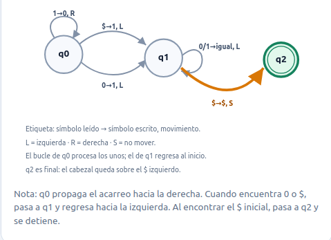

# Ejercicio 4 — El contador binario en una máquina de Turing, con potencial

★★ · Conferencias 1 y 4.

## Enunciado

Para la máquina de Turing del ejercicio 7 de la conferencia 1, que suma 1 a un número en binario y devuelve el cabezal al bit menos significativo, demuestra **con un potencial** que n incrementos desde 0 cuestan O(n) pasos en total, aunque uno solo pueda costar Θ(log n). Es la pregunta que la conferencia 1 dejó abierta.

*Interpretación.* El PDF deja en blanco las tres cotas; el párrafo dice "n incrementos desde 0 cuestan ___ pasos en total, aunque uno solo pueda costar ___". Las leo como **O(n)** total y **Θ(log n)** para uno solo, que es lo que la hoja de la conferencia 1 calcula con la serie ∑⌊m/2ⁱ⌋ < 2m. Lo que aquí se pide es la **misma cota por el método de la conferencia 4**: un potencial, no una serie.

## Preguntas que deberías poder responder

**P1.** ¿Cuánto cuesta exactamente un incremento de la máquina del ejercicio 7 de la conferencia 1?

**R1.** Si el número termina en exactamente k unos, el estado q_c recorre esas k celdas hacia el bit más significativo y escribe un 1, y el estado q_v vuelve a la derecha hasta el blanco posterior al bit menos significativo. Ida y vuelta: c = 2k + O(1) pasos.

**P2.** ¿Por qué el regreso al bit menos significativo no se puede omitir?

**R2.** Porque la máquina se aplica n veces seguidas y la siguiente aplicación supone el cabezal en el bit menos significativo. Sin el regreso, cada corrida arrancaría en el sitio equivocado. El regreso es lo que duplica la constante y no cambia nada más.


**P4.** ¿Qué deuda acumula la estructura, y qué la paga?

**R4.** Cada 1 escrito en la cinta es un acarreo futuro: alguna vez habrá que apagarlo, y apagarlo cuesta dos pasos (ir y volver). El potencial tiene que ser proporcional al número de unos, y el incremento caro es el que cobra esa deuda de golpe.

**P5.** ¿Por qué el incremento **solo** sí se amortiza y con `decrementar` no?

**R5.** Porque `incrementar` apaga k unos y enciende uno: solo gasta unos que alguien pagó antes. `decrementar` fabrica k unos de golpe a costo k, y entonces el potencial sube sin que nadie lo haya pagado; el ejercicio 2 de la conferencia 4 exhibe la oscilación 1000⋯0 ↔ 0111⋯1 que cuesta Θ(n) por operación.

**P6.** ¿Qué dos condiciones del telescopio hay que comprobar aquí?

**R6.** Que Φ ≥ 0 siempre (es un conteo de unos, sí) y que Φ(D₀) = 0 (se arranca en 0, sin unos, sí). Con eso ∑cᵢ ≤ ∑aᵢ y no hay que pagar nada aparte.

## Cómo encajan

El costo real de un incremento es proporcional a la longitud del acarreo (P1–P2), y la longitud del acarreo es el número de unos que se apagan. El potencial tiene que medir exactamente esos unos pendientes (P4), con la constante justa para que el ida y vuelta quede cubierto. Entonces el incremento caro, que apaga k unos, se paga con la caída del potencial, y el amortizado queda constante. Es la misma estructura del ejercicio 2 de la conferencia 4, con el factor 2 de la cinta añadido.

## Solución


hacer un grupo de fotos que vayan explicando paso a paso la suma de 1 al numero binario 11,
y de 1 al numero binario 10, con acarreo, y todo lo demas y como llevar eso a una m'aquina de turing

inicialmente vamos a hacerlo con sumarle 1 a 1111


poner el ejemplo de qué pasaría al procesar un ejemplo del peor caso, y verlo con el potencial
**P3.** ¿Cuál es el peor caso de un solo incremento?

**R3.** El valor 2ᵏ − 1, escrito como k unos: el acarreo recorre los k bits. Tras n incrementos desde 0 el valor es n, que tiene ⌊log₂ n⌋ + 1 bits, así que k llega a ⌊log₂ n⌋ y un incremento suelto cuesta Θ(log n).


Duda: que significa sumarle 1 a un numero binario?? como se transforma el numero binario en esa operacion, cu'al es el bit menos significativo en un número binario? que singifica que el cabezal comience en el bit menos significativo y que deba volver a él?? 


La modificación principal consiste en adaptar la máquina de Turing a una cinta que utiliza `$` como delimitador izquierdo y como símbolo de las posiciones vacías a la derecha del número. Esto permite realizar incrementos consecutivos sin tener que desplazar o reescribir el número en cada operación.

Hay un detalle importante: **la dirección de los movimientos debe cambiar respecto a la tabla original**, porque ahora el bit menos significativo está a la izquierda y el más significativo a la derecha.

# 1. Descripción de la máquina de Turing

Construiremos una máquina de Turing de una cinta que realiza incrementos de uno sobre un número binario.

Su funcionamiento consiste en:

1. Recibir un número binario en la cinta.
2. Sumarle uno.
3. Resolver los posibles acarreos.
4. Regresar el cabezal a la posición inicial.
5. Detenerse cuando encuentre el delimitador izquierdo `$`.

La máquina utiliza tres estados:

- **q0:** realiza la suma y resuelve los acarreos.
- **q1:** regresa el cabezal hasta el inicio del número.
- **q2:** estado final. La operación ha terminado.

# 2. Representación de la cinta

La cinta se inicializa utilizando la siguiente estructura:

```text
$  número binario  $ $ $ $ $ ...
```

El número se representa con el bit menos significativo (LSB) a la izquierda y el más significativo (MSB) a la derecha.

Por ejemplo, el número binario `11100` se representa así:

```text
$ 0 0 1 1 1 $ $ $ $ ...
  ↑
 Cabezal
```

El primer `$` funciona como delimitador izquierdo. Los `$` posteriores al número representan las posiciones vacías disponibles para almacenar nuevos bits.

Esta representación permite que, cuando se produzca un acarreo que aumente la longitud del número, la máquina pueda utilizar directamente la siguiente posición de la cinta.

# 3. Funcionamiento de la máquina

La máquina comienza con el cabezal sobre el bit menos significativo, es decir, el primer bit situado inmediatamente después del delimitador izquierdo `$`.

Existen tres situaciones posibles:

### Caso 1. El bit actual es 1

Si el cabezal encuentra un `1`, significa que el acarreo debe continuar.

La máquina:

1. Cambia el `1` por `0`.
2. Mueve el cabezal una posición hacia la derecha.
3. Permanece en el estado q0.
4. Continúa buscando el siguiente bit.

Esto sucede porque, en binario:

```text
1 + 1 = 0 (con acarreo de 1)
```

Por tanto, mientras encuentre unos consecutivos, los irá convirtiendo en ceros.

### Caso 2. El bit actual es 0

Si el cabezal encuentra un `0`, significa que el acarreo puede resolverse.

La máquina:

1. Cambia el `0` por `1`.
2. Mueve el cabezal hacia la izquierda.
3. Cambia al estado q1.

Esto ocurre porque:

```text
0 + 1 = 1
```

Ya no existe acarreo, por lo que no es necesario continuar recorriendo el número hacia la derecha.

### Caso 3. El cabezal encuentra $

Si el cabezal encuentra `$` mientras está en q0, significa que todos los bits del número eran `1`.

Por tanto, el incremento necesita agregar un nuevo bit.

La máquina:

1. Sustituye `$` por `1`.
2. Mueve el cabezal hacia la izquierda.
3. Cambia al estado q1.

Por ejemplo:

```text
111 + 1 = 1000
```

En nuestra representación:

```text
Antes:    $ 1 1 1 $ $ $
Después:  $ 0 0 0 1 $ $
```

El nuevo bit se incorpora directamente en la posición vacía siguiente.

### Regreso a la posición inicial

Una vez resuelto el acarreo, la máquina debe regresar al comienzo del número.

Para ello utiliza el estado q1:

1. Si encuentra `0` o `1`, conserva el valor actual.
2. Mueve el cabezal una posición hacia la izquierda.
3. Continúa en q1.
4. Cuando encuentra `$`, mueve el cabezal una posición hacia la derecha (quedando sobre el bit menos significativo), cambia al estado final q2 y se detiene.

De esta manera, el cabezal siempre termina sobre la primera celda del número (el bit menos significativo).

---

# 4. Tabla de transiciones

La máquina utiliza el siguiente conjunto de transiciones:

| Estado actual | Lee | Escribe | Movimiento | Estado siguiente | Descripción |
|---|---|---|---|---|---|
| q0 | 1 | 0 | R | q0 | Convierte el 1 en 0 y continúa el acarreo. |
| q0 | 0 | 1 | L | q1 | Resuelve el acarreo y comienza el regreso. |
| q0 | $ | 1 | L | q1 | Agrega un nuevo bit por desbordamiento. |
| q1 | 0 | 0 | L | q1 | Regresa hacia el inicio. |
| q1 | 1 | 1 | L | q1 | Regresa hacia el inicio. |
| q1 | $ | $ | R | q2 | Alcanza el delimitador, vuelve a la derecha al LSB y termina. |

**Significado de los movimientos:**

- `R`: mueve el cabezal hacia la derecha.
- `L`: mueve el cabezal hacia la izquierda.
- `S`: permanece en la misma posición.





A la máquina de Turing del html, y a la del .md se les ha ajustado que al encontrar en q1 el símbolo `$` se muevan hacia la derecha para quedar en el bit menos significativo en q2.


El estado q2 es el estado de aceptación o finalización.

# 6. Ejemplo de ejecución: sumar 1 a 11100

El número `11100` se representa en la cinta como:

```text
$ 0 0 1 1 1 $ $ $
  ↑
```

El cabezal comienza en q0.

Como el primer bit es `0`, la máquina lo cambia a `1` y pasa a q1.

La ejecución es:

| Paso | Estado | Cinta | Acción |
|---|---|---|---|
| 0 | q0 | `$ 0 0 1 1 1 $ $` | Comienza. |
| 1 | q1 | `$ 1 0 1 1 1 $ $` | Convierte el primer 0 en 1. |
| 2 | q1 | `$ 1 0 1 1 1 $ $` | Regresa hacia la izquierda. |
| 3 | q1 | `$ 1 0 1 1 1 $ $` | Encuentra el delimitador. |
| 4 | q2 | `$ 1 0 1 1 1 $ $` | Mueve a la derecha sobre el LSB y termina. |

El resultado es:

```text
Representación en cinta: $10111$$$
Número binario:          11101
```

Por tanto:

```text
11100 + 1 = 11101
```

# 7. Ejemplo de ejecución: sumar 1 a 111

Este ejemplo permite observar cómo funciona el acarreo y cómo se agrega un nuevo bit.

Representación inicial:

```text
$ 1 1 1 $ $ $
  ↑
```

La máquina comienza en q0.

**Primera iteración:**

Encuentra `1`, lo convierte en `0` y avanza hacia la derecha.

```text
$ 0 1 1 $ $ $
    ↑
```

**Segunda iteración:**

Encuentra otro `1`, lo convierte en `0` y continúa.

```text
$ 0 0 1 $ $ $
      ↑
```

**Tercera iteración:**

Encuentra otro `1`, lo convierte en `0` y continúa.

```text
$ 0 0 0 $ $ $
        ↑
```

**Cuarta iteración:**

Encuentra `$`. Esto significa que todos los bits originales eran unos y que el número necesita un bit adicional.

Lo sustituye por `1` y pasa a q1.

```text
$ 0 0 0 1 $ $
      ↑
```

Finalmente, q1 desplaza el cabezal hacia la izquierda hasta encontrar el delimitador inicial, para luego avanzar 1 posición a la derecha hasta el LSB.

```text
$ 0 0 0 1 $ $
  ↑
```

La máquina termina en q2.

El resultado es:

```text
Representación en cinta: $0001$$$
Número binario:          1000
```

Por tanto:

```text
111 + 1 = 1000
```

---


**Modelo y estructura.** Máquina de Turing de una cinta sobre {0, 1, B}, el número en binario con el bit menos significativo a la izquierda y el cabezal sobre él. El costo es el número de pasos. El estado D_i es el contenido de la cinta tras el i-ésimo incremento. Las transiciones son las del ejercicio 7 de la conferencia 1:

Para optimizar el procesamiento se va a asumir que en la cinta de la maquina de turing se va a comenzar con el carácter $, luego el numero binario que tendrá el bit menos significativo a la izquierda y el más significativo a la derecha, y luego infinitos caracteres $.
Quedando un numero como 11100  representado en la cinta como $00111$$$...
para permitir con esto que se puedan hacer n sumas sin complejidad de tener que reescribir el número nuevamente.


agregar una explicación de qué es lo que hace la máquina de turing
en vez de qc, qv y qh, cambiame los estados a q0, q1, q2, en el grafo, en la representación visual en vez de un espacio en blanco, que el html ponga un símbolo $,

la máquina de turing comienza con el cabezal en el bit menos significativo, segun la representacion que estamos utilizando de la cinta, ese bit seria el que está más a la izquierda.
Si ese bit es 1 entonces la maquina lo cambia a 0 y mueve el cabezal a la derecha, y se mantiene haciendo esto mientras siga encontrando 1, los otros dos casos son que
- al moverse a la derecha encuentra el bit 0, entonces lo convierte en 1 y procede a buscar el bit menos significativo nuevamente
- al moverse a la derecha se encuentre con el símbolo $, entonces quiere decir que tiene 1 de acarreo la suma y que el número aumenta en un bit, por tanto se convierte ese simbolo a 1, y se procede a mover al cabezal hacia el bit menos significativo nuevamente.


Como se mueve el cabezal hasta el bit menos significativo, sin importar si el valor del bit es 0 o 1, se deja este valor en la cinta, se mueve a la izquierda repetidamente hasta encontrar el valor $ en la cinta, y ahí rebota a la derecha para posicionarse en el bit menos significativo y se detiene la máquina.

```text
estado   lee   escribe   mueve   nuevo estado
q_c      1     0         L       q_c          (apaga un 1, el acarreo sigue)
q_c      0     1         R       q_v          (enciende el 1, el acarreo para)
q_c      B     1         R       q_v          (el número creció un bit)
q_v      0/1   igual     R       q_v          (vuelve hacia el inicio)
q_v      B     B         R       q_h          (vuelve a la derecha y se detiene sobre el LSB)
```


Nota: Revisar con detalles la máquina de Turing y ver si funciona bine, y si funciona bien mostrarla comoun grafo

y ver si es posible hacer una visualización de la máquina de turing ejecutándose paso a paso y a un lado ponerle la parte de el potencial como va variando a la vez que la máquina va advancing,
 de manera que se le pueda introducir cualquier valor en bits a la máquina de turing y que ella haga el movimiento para sumarle 1


# Análisis amortizado del contador binario con máquina de Turing

## 1. Costo real de una operación

Sea \(k\) el número de unos consecutivos que encuentra la máquina comenzando por el bit menos significativo (el bit situado más a la izquierda en nuestra representación).

El costo de un incremento se divide en dos recorridos:

**Primer recorrido: propagación del acarreo (q0).**

- La máquina encuentra \(k\) unos consecutivos y convierte cada uno en cero, advancing hacia la derecha.
- Después encuentra un cero o un símbolo `$`. En cualquiera de los dos casos escribe un uno y comienza el regreso.

Por tanto, q0 realiza \(k+1\) pasos.

**Segundo recorrido: regreso al inicio (q1).**

- Después de resolver el acarreo, el cabezal se encuentra una posición a la izquierda del último símbolo procesado.
- Recorre hacia la izquierda los \(k\) bits que fueron modificados.
- Finalmente, encuentra el delimitador inicial `$`, se mueve un paso a la derecha hacia el LSB y termina la ejecución.

Este recorrido requiere \(k+2\) pasos.

Por tanto, el costo real de un incremento es:

\[
c = (k+1)+(k+2)
\]

\[
\boxed{c=2k+3}
\]

El costo depende del número de unos consecutivos que deben procesarse. Si hay muchos unos desde el bit menos significativo, el acarreo necesita recorrerlos todos y posteriormente regresar.

## 2. El potencial

Definimos la función de potencial como:

\[
\boxed{\Phi(D)=2\cdot(\text{número de unos en el número binario})}
\]

El potencial representa una reserva de trabajo acumulado que permitirá compensar el costo de los incrementos que necesiten propagar un acarreo largo.

Se cumplen las dos condiciones necesarias:

- **\(\Phi(D)\geq 0\).** El potencial es dos veces un conteo de unos, por lo que nunca puede ser negativo.
- **\(\Phi(D_0)=0\).** La máquina comienza con el número cero, representado como `$0$$$...`, que no contiene ningún uno.

Por tanto, las condiciones necesarias para aplicar el método del potencial se cumplen.

La suma de los costos amortizados permitirá acotar el costo real total sin tener que analizar individualmente cada incremento.

## 3. Costo amortizado

Recordemos que el costo amortizado se define como:

\[
a_i=c_i+\Delta\Phi_i
\]

donde:

- \(c_i\) es el costo real de la operación.
- \(\Delta\Phi_i=\Phi(D_i)-\Phi(D_{i-1})\) es el cambio del potencial.

Consideremos un incremento que encuentra \(k\) unos consecutivos comenzando por el bit menos significativo.

Durante la operación:

- Los \(k\) unos encontrados se convierten en ceros.
- Se enciende exactamente un nuevo uno, independientemente de si se encontró un cero o un `$`.

Por tanto, si antes del incremento había \(u\) unos, después habrá:

\[
u'=u-k+1
\]

El cambio del potencial es:

\[
\Delta\Phi=2(u'-u)
\]

Sustituyendo:

\[
\Delta\Phi=2(u-k+1-u)
\]

\[
\boxed{\Delta\Phi=2-2k}
\]

Ahora calculamos el costo amortizado:

\[
a=c+\Delta\Phi
\]

Sustituyendo el costo real y el cambio del potencial:

\[
a=(2k+3)+(2-2k)
\]

Simplificando:

\[
\boxed{a=5}
\]

Por tanto, **cada incremento tiene un costo amortizado constante de 5 pasos**, independientemente de cuántos unos consecutivos tenga que procesar.

La cantidad \(k\) desaparece de la expresión porque el trabajo adicional de recorrer los unos se compensa con la disminución del potencial acumulado.

## 4. El costo total de n incrementos

Para calcular el costo real de una secuencia de \(n\) incrementos, utilizamos la relación entre el costo real y el amortizado:

\[
a_i=c_i+\Phi(D_i)-\Phi(D_{i-1})
\]

Sumando para las \(n\) operaciones:

\[
\sum_{i=1}^{n}a_i
=
\sum_{i=1}^{n}c_i
+
\Phi(D_n)-\Phi(D_0)
\]

Despejando el costo real total:

\[
\sum_{i=1}^{n}c_i
=
\sum_{i=1}^{n}a_i
+
\Phi(D_0)-\Phi(D_n)
\]

Sabemos que:

- Cada operación tiene costo amortizado 5.
- El potencial inicial es cero.
- El potencial final nunca es negativo.

Por tanto:

\[
\sum_{i=1}^{n}c_i
\leq
5n+0
\]

Finalmente:

\[
\boxed{\sum_{i=1}^{n}c_i=O(n)}
\]

Además, cada incremento requiere al menos un número constante de pasos, por lo que el costo total también está acotado inferiormente por una función lineal:

\[
\sum_{i=1}^{n}c_i=\Omega(n)
\]

En consecuencia:

\[
\boxed{\sum_{i=1}^{n}c_i=\Theta(n)}
\]

**Conclusión:** realizar \(n\) incrementos consecutivos desde cero requiere un total de \(\Theta(n)\) pasos.

## 5. El peor caso de una sola operación

Aunque el costo amortizado de cada incremento es constante, eso no significa que todas las operaciones individuales tengan un costo constante.

Consideremos el incremento número \(2^k\).

Justo antes de realizarlo, el contador contiene:

\[
2^k-1
\]

En representación binaria, ese número está formado por \(k\) unos consecutivos:

\[
2^k-1=\underbrace{11\ldots11}_{k\text{ unos}}
\]

Por tanto, la máquina debe:

1. Recorrer los \(k\) unos, convirtiéndolos en ceros.
2. Encontrar el siguiente `$` y convertirlo en uno.
3. Regresar al delimitador inicial y avanzar un paso a la derecha.

El costo de esta operación es:

\[
c=2k+3
\]

Como el contador alcanza el valor \(n\) después de \(n\) incrementos, su representación necesita como máximo:

\[
\lfloor\log_2 n\rfloor+1
\]

bits.

El mayor acarreo que puede aparecer durante esos \(n\) incrementos tiene una longitud de \(\lfloor\log_2 n\rfloor\) unos.

Por tanto, el peor caso de una operación individual es:

\[
\boxed{c_{\text{máximo}}=\Theta(\log n)}
\]

No existe contradicción entre este resultado y el costo total \(\Theta(n)\).

Los incrementos que necesitan recorrer muchos unos son poco frecuentes. Por ejemplo, un incremento que necesita procesar \(k\) unos consecutivos ocurre una vez cada \(2^k\) incrementos.

El potencial acumulado durante las operaciones anteriores permite compensar el costo adicional de esos incrementos.

## 6. Comparación con la cuenta de la conferencia 1

En la conferencia 1 se utilizaba otra forma de demostrar que el costo total de los incrementos es lineal.

La idea consistía en contar cuántas veces cambia cada posición binaria.

El bit de posición \(i\) cambia una vez cada \(2^i\) incrementos. Por tanto, durante \(n\) incrementos, el número total de cambios puede acotarse mediante:

\[
\sum_{i\geq 0}\left\lfloor\frac{n}{2^i}\right\rfloor
<
\sum_{i\geq 0}\frac{n}{2^i}
\]

Sacando \(n\) como factor común:

\[
=n\sum_{i\geq 0}\frac{1}{2^i}
\]

La serie geométrica vale 2:

\[
\boxed{\sum_{i\geq 0}\left\lfloor\frac{n}{2^i}\right\rfloor<2n}
\]

De esta manera, se obtiene nuevamente una cota lineal para el trabajo total.

Ambos métodos llegan al mismo resultado, pero utilizan perspectivas diferentes:

- **Método de la conferencia 1:** agrupa el trabajo por posición binaria y cuenta cuántas veces cambia cada bit.
- **Método del potencial:** agrupa el trabajo por operación y utiliza los unos acumulados como una reserva que permite pagar los incrementos más costosos.

La ventaja del método del potencial es que permite demostrar directamente que cada incremento tiene un costo amortizado constante, sin necesidad de conocer de antemano cuántos incrementos se realizarán.

## 7. Conclusión

Utilizando la función de potencial:

\[
\boxed{\Phi(D)=2\cdot(\text{número de unos en el número binario})}
\]

demostramos que:

- El potencial siempre es no negativo.
- El potencial inicial es cero.
- Cada incremento tiene un costo amortizado constante de 5.
- Realizar \(n\) incrementos desde cero requiere un costo total de \(\Theta(n)\).
- El peor caso de un incremento individual sigue siendo \(\Theta(\log n)\).

Por tanto, aunque una operación individual puede necesitar recorrer varios bits para resolver un acarreo, el costo promedio amortizado por operación permanece constante.

Esto es precisamente lo que estudia el análisis amortizado de la conferencia 4: **no garantiza que cada operación individual sea barata, sino que garantiza que el costo total de una secuencia de operaciones esté acotado.**


**Costo real de una operación.** Sea k el número de unos finales del valor actual. El estado q_c da k pasos sobre los unos más 1 para escribir el 1. El estado q_v recorre esos k + 1 bits más una celda y retrocede una. Luego

```
c  =  2k + C,      con C una constante absoluta (C = 5 con las transiciones de arriba)
```

**El potencial.**

```
Φ(D)  =  2 · (número de unos en la cinta)
```

- *Φ ≥ 0.* Es dos veces un conteo.
- *Φ(D₀) = 0.* Se arranca en 0, sin ningún 1 escrito.

Las dos condiciones del telescopio se cumplen, así que ∑cᵢ ≤ ∑aᵢ sin pagar nada aparte.

**Costo amortizado.** Un incremento con k unos finales apaga esos k unos y enciende exactamente uno (sea en el 0 que encontró, sea en el blanco). El número de unos pasa de u a u − k + 1, luego

```
ΔΦ  =  2(1 − k)  =  2 − 2k

a   =  c + ΔΦ  =  (2k + C) + (2 − 2k)  =  C + 2
```

El amortizado es **constante**, y la k desapareció: el ida y vuelta del acarreo lo paga entero la caída del potencial.

**El total.** Para n incrementos desde 0, con Φ ≥ 0 y Φ(D₀) = 0:

```
∑ cᵢ  =  ∑ aᵢ + Φ(D₀) − Φ(D_n)  ≤  (C + 2)·n  =  O(n)
```

Y es Ω(n), porque cada incremento da al menos los O(1) pasos de q_v: el total es **Θ(n)**.

**El peor caso de una sola operación.** El incremento número 2ᵏ, que actúa sobre el valor 2ᵏ − 1 = 1ᵏ, apaga los k unos: cuesta 2k + C. Tras n incrementos el valor máximo es n, con ⌊log₂ n⌋ + 1 bits, así que hay un incremento de costo **Θ(log n)**. No hay contradicción con el total Θ(n): esos incrementos caros son raros y ya estaban pagados. En concreto, el incremento de costo ≈ 2k ocurre una vez cada 2ᵏ, y los 2ᵏ incrementos baratos anteriores subieron el potencial lo justo.

**Comparación con la cuenta de la conferencia 1.** Allí se sumaba, sobre los bits, el número de veces que cada uno cambia:

```
∑_{i≥0} ⌊n / 2ⁱ⌋  <  ∑_{i≥0} n / 2ⁱ  =  2n
```

Es la misma cota por el otro lado del reparto: la serie cuenta el trabajo agrupado **por bit**, el potencial lo cuenta agrupado **por operación**. La ventaja del potencial es que no necesita conocer de antemano la secuencia: la desigualdad a ≤ C + 2 vale para el estado que sea, así que la cota sobrevive si se intercalan otras operaciones que no suban el potencial (leer el valor, copiarlo), mientras que la serie habría que rehacerla.

**Conclusión.** Con Φ = 2·(unos en la cinta), cada incremento cuesta O(1) amortizado, n incrementos desde 0 cuestan Θ(n) pasos, y el peor caso de uno solo sigue siendo Θ(log n). Es exactamente lo que la conferencia 4 llama costo amortizado: una garantía de peor caso sobre la **secuencia**, no sobre la operación.

## Para complementar después

Implementar la máquina de turing

- Instrumentar la máquina paso a paso y pegar la tabla de pasos reales y de Φ para los primeros 32 incrementos, para ver el pico de costo en 2ᵏ − 1 junto con la caída del potencial que lo paga.
- Añadir la figura de la cinta antes y después del incremento 16 (de `01111` a `10000`) con el camino del cabezal marcado, que es el caso donde la cuenta se ve entera.
- Rehacer la cuenta con una representación redundante de dígitos {0, 1, 2} y comprobar que allí sí se consigue O(1) amortizado con las dos operaciones, lo que separa el problema de la representación.
- Comparar el total medido con 2n y con la serie ∑⌊n/2ⁱ⌋ para n hasta 10⁵, para ver cuánto margen deja la constante C + 2 frente al costo real.