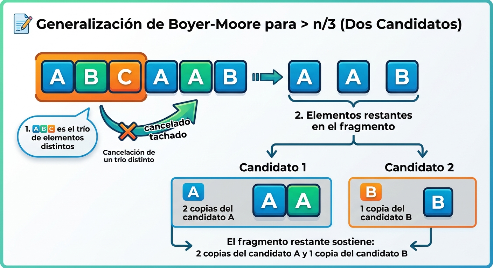
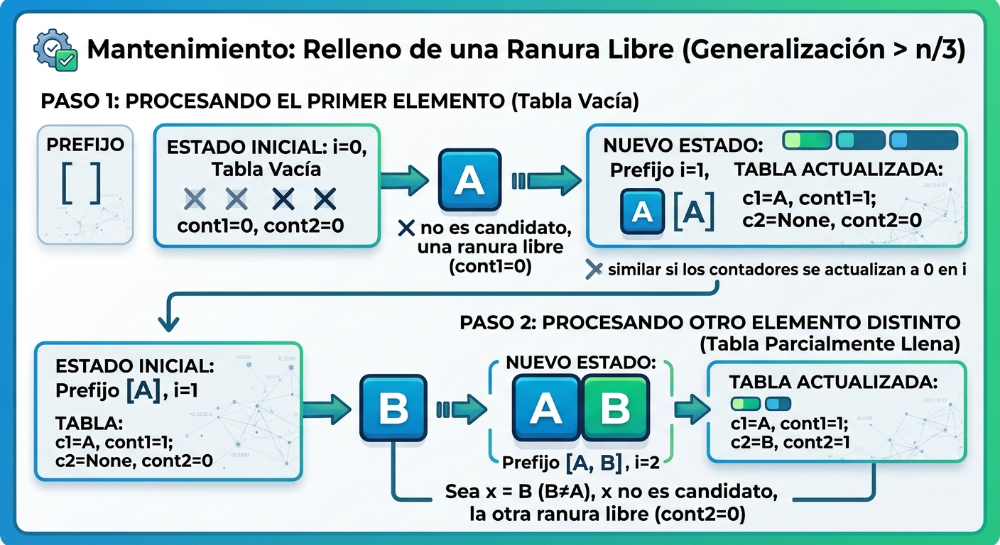
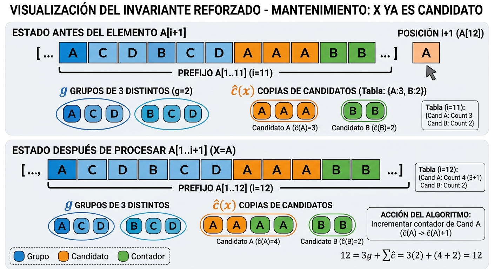
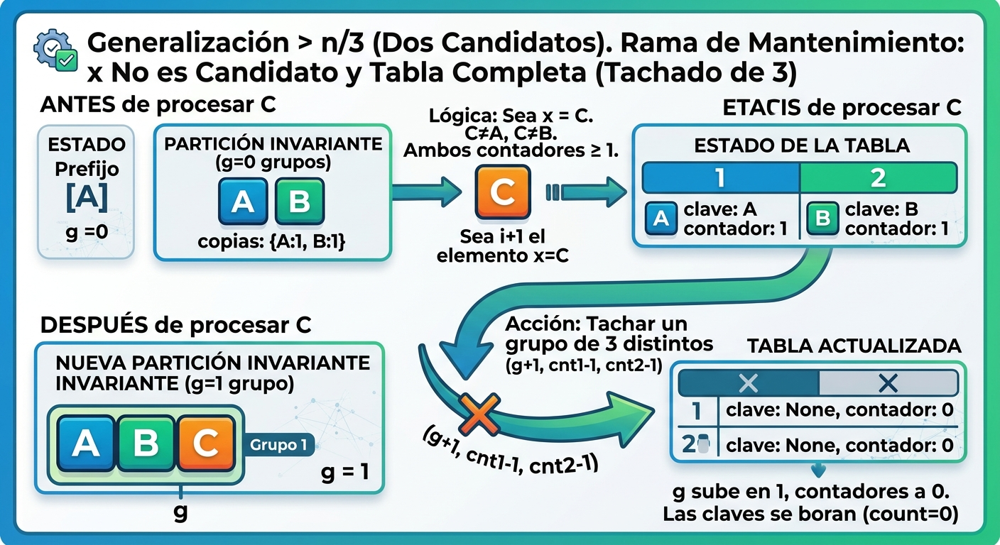

# Ejercicio 8 — El elemento que aparece más de n/3 veces

★★ · Conferencia 3.

## Enunciado

Generaliza Boyer-Moore con **dos candidatos** para encontrar los elementos que aparecen más de n/3 veces. Enuncia el invariante reforzado y demuéstralo. Después escribe la versión que devuelve los candidatos con contador positivo **sin verificarlos**, y busca un generador de pruebas que no la atrape. Cuidado: el análogo del generador binario de la conferencia 3 sí la atrapa.

## Cómo encajan

El invariante reforzado es el de Misra-Gries con k = 3 escrito como una partición del prefijo (P3): grupos de tres distintos más las copias que anuncian los contadores. De ahí sale, con el conteo de P2, el teorema en un solo sentido, "todo frecuente está en la tabla"; la recíproca es falsa y por eso hace falta la segunda pasada. El atajo la borra, y para decidir qué generador lo atrapa hay que leer bajo qué hipótesis el teorema se vuelve bicondicional (P5). La sorpresa es que la lección de la conferencia 3 se invierte: el alfabeto pequeño, que allí escondía el error, aquí lo destapa.

## Solución

**Problema.** Dado A de n elementos comparables solo por igualdad, devolver todos los elementos que aparecen más de n/3 veces. Modelo: comparaciones por igualdad; memoria estricta O(1).


Para cualquier arreglo $A$ de tamaño $n$, como máximo puede haber dos elementos que aparezcan más de $n/3$ veces, ya que si existieran tres, al sumar sus apariciones superarían el total de $n$ elementos ($3 \times n/3 = n$), lo cual es imposible. A partir de esto, si un elemento aparece $p$ veces con $p > n/3$, al restarle 1 la proporción que se sige cumpliendo es
p-1 > n/3 - 1
p-1 > (n-3)/3, lo que se podría ver como que al tacharlo junto con otros dos elementos distintos nos quedan $n-3$ elementos y al menos $p-1$ copias de él, por lo que su frecuencia sobrevive a la cancelación de ese trío. Esto nos lleva a ver que cualquier arreglo se puede entender como una estructura formada por $g \ge 0$ grupos de tres elementos distintos dos a dos, más las copias que sostienen los dos candidatos finales, $c_1$ y $c_2$, en el fragmento restante.




 En la imagen anterior se ve el array dispuesto de manera que se vea el caso que se quiere mostrar, pero de no cumplirse este caso, en todo array permutando sus elementos se podría llegar a que se cumple la proposición anterior


como funciona el algoritmo:

El algoritmo opera en dos fases con espacio continuo $O(1)$:

1. **Primera pasada (Fase de eliminación / Selección de candidatos):**
   * Inicializamos dos candidatos (`c1`, `c2`) vacíos con sus respectivos contadores (`cnt1`, `cnt2`) en $0$.
   * Recorremos el arreglo elemento por elemento:
     * **Coincidencia:** Si el elemento actual es igual a `c1` o `c2`, incrementamos su contador correspondiente en $1$.
     * **Asignación de espacio libre:** Si algún candidato no tiene asignado un elemento (su contador está en $0$), el nuevo elemento ocupa ese lugar con un contador inicial de $1$.
     * **Cancelación de tríos:** Si ambos candidatos están ocupados y el nuevo elemento es distinto a los dos, se resta $1$ a ambos contadores. Esto equivale a **tachar un trío de 3 elementos distintos dos a dos** (una ocurrencia de `c1`, una de `c2` y el elemento actual). Cuando un contador llega a $0$, su casilla de candidato queda libre.

2. **Segunda pasada (Fase de verificación):**
   * La primera pasada únicamente garantiza que **ningún elemento con más de $n/3$ apariciones ha sido descartado**, pero no asegura que los candidatos finales cumplan la condición.
   * Por ello, contamos las frecuencias reales de los dos candidatos resultantes en el arreglo $A$ y conservamos solo aquellos cuya cantidad de apariciones sea estrictamente mayor que $n/3$.


Primero se inicializan 2 contadores y 2 variables que almacenan el elemento de cada contador. Luego se comienza a procesar los elemntos del array, si al procesar el elemento no hay candidatos elegidos, se asume él como uno de los dos candidatos y se le pone como contador 1, si hay solo un candidato elegido y es distinto de él, se asume el elemento como el otro candidato disponible. 
Si ya están elegidos todos loscandidatos y el elemento es distinto a todos ellos, pues se le resta 1 al contador de cada candidato, pues el elemento nuevo junto con 1 frecuencia de el candidato1 y 1 frecuencia del candidato2 forma 1 trío de 3 elementos distintos
**Algoritmo (dos candidatos, dos pasadas, memoria estricta O(1)).**

```python
def mas_de_un_tercio(A):
    c1, c2 = None, None
    cnt1, cnt2 = 0, 0
    
    for x in A:                             # 1ª pasada: cancelar
        if c1 == x:
            cnt1 += 1
        elif c2 == x:
            cnt2 += 1
        elif cnt1 == 0:
            c1, cnt1 = x, 1
        elif cnt2 == 0:
            c2, cnt2 = x, 1
        else:                               # tachar un grupo de 3 distintos
            cnt1 -= 1
            cnt2 -= 1
            if cnt1 == 0:
                c1 = None
            if cnt2 == 0:
                c2 = None
                
    n = len(A)                              # 2ª pasada: verificar
    candidatos = []
    if c1 is not None: 
        candidatos.append(c1)
    if c2 is not None and c2 != c1: 
        candidatos.append(c2)
        
    return sorted([c for c in candidatos if A.count(c) > n // 3])
```

**Invariante reforzado.** Después de procesar el prefijo A[1..i], ese prefijo se puede partir en

> g grupos de **tres** elementos distintos dos a dos, más ĉ(x) copias de cada candidato x de la tabla,

donde ĉ(x) es su contador. En particular i = 3g + Σₓ ĉ(x), y todo contador presente es ≥ 1.

- *Inicialización.* Prefijo vacío, tabla vacía: g = 0 grupos y cero copias, 0 = 3·0 + 0. ✓
- *Mantenimiento.* Sea el invariante cierto para A[1..i] y sea x = A[i+1]. Existen tres ramas:

- *x no es candidato y la tabla tiene menos de 2 pares (es decir, algún contador es 0 / ranura libre).* Entra con contador 1; otra vez una copia nueva. ✓




- *x ya es candidato.* Si x ya es candidato, entonces en ese punto hay una particion que tiene 3g + ĉ(x) + ĉ(y), que se mantiene igual solo que ĉ(x) sube en 1; la partición nueva es la vieja más una copia de x. Los grupos no cambian, y 3g + Σĉ sube en 1. ✓



- *x no es candidato y la tabla tiene exactamente 2 pares activos.* Los dos contadores son ≥ 1, así que la partición vieja contiene al menos una copia de cada candidato. Tomo una copia de cada uno y le añado x: son tres elementos distintos dos a dos, porque las dos claves son distintas entre sí y x no es ninguna. Ese es un grupo nuevo, g sube en 1, y de cada candidato quedan ĉ − 1 copias, que es lo que el algoritmo deja (y las claves que llegan a 0 se borran con sus 0 copias). La cuenta cuadra: 3(g+1) + (Σĉ − 2) = 3g + Σĉ + 1. ✓




Aunque no estaban consecutivos la pareja de 3, el algoritmo la encuentra.


- *Conclusión.* Al terminar la primera pasada, A entero se parte en g grupos de tres distintos más ĉ(x) copias de cada candidato, con n = 3g + Σₓ ĉ(x). Sea m con cuenta(m) > n/3 y supongamos que m **no** está en la tabla. Entonces m solo aparece dentro de los grupos, y a lo sumo una vez en cada uno porque sus tres elementos son distintos. Luego

```
cuenta(m)  ≤  g  =  (n − Σₓ ĉ(x)) / 3  ≤  n / 3
```

contra cuenta(m) > n/3. Por tanto:

> **Teorema.** Todo elemento con más de n/3 apariciones está en la tabla al final de la primera pasada.

La implicación va en **un solo sentido**. La recíproca es falsa, pueds la tabla puede contener algún elemento que no aparezca más de n/3 veces, con A = `a a b` la tabla acaba en `a:2, b:1` y b aparece una vez, que no es más de 3/3 = 1.

**Costo.** Primera pasada: O(1) comparaciones por elemento (la tabla tiene a lo sumo dos entradas) y a lo sumo 2 decrementos por elemento, O(n) en total. Segunda pasada: dos recorridos para contar, O(n). Memoria estricta O(1). Dos pasadas, y ninguna sobra.

---

### La versión sin verificar, y el generador que no la atrapa


### Explicación del Código y la Prueba del Atajo

Este código sirve para demostrar por qué un generador de pruebas ingenuo **falla en detectar el error** de la función `atajo` (la versión que omite la segunda pasada de verificación).

---

### 1. ¿Cómo funcionan las funciones principales?

* **`atajo(A)`:** 
  Ejecuta solo la primera pasada del algoritmo de Boyer-Moore generalizado. Devuelve directamente cualquier candidato que mantenga un contador mayor a cero al finalizar el recorrido, **sin comprobar cuántas veces aparece realmente en el arreglo**.

* **`solucion_correcta(A)`:** 
  Realiza el algoritmo completo. Primero obtiene los candidatos finales de la tabla y luego hace una **segunda pasada** para contar las frecuencias exactas en $A$, devolviendo únicamente los elementos cuya cantidad sea estrictamente mayor a $n/3$.

---

### 2. ¿Cómo funciona el generador `generar_instancia_que_no_atrapa`?

Este generador construye un arreglo $A$ de tamaño $n$ forzando la siguiente estructura:

1. **Planta obligatoriamente 2 elementos muy frecuentes:** 
   Calcula $k = (n // 3) + 1$ e inserta $k$ copias de `elem_0` y $k$ copias de `elem_1`.
2. **Rellena el espacio restante:** 
   Completa los elementos faltantes hasta llegar a $n$ usando otros símbolos aleatorios del alfabeto.
3. **Mezcla el arreglo (`shuffle`):** 
   Reordena de forma aleatoria todos los elementos introducidos.

---

### 3. ¿Por qué este generador NO atrapa el fallo del atajo?

* Al plantar **dos elementos** que aparecen más de $n/3$ veces, la hipótesis del problema garantiza que **ambos dominarán la tabla** y sobrevivirán a todas las cancelaciones de tríos.
* Como los dos elementos presentes son **efectivamente frecuentes**, la tabla final termina ocupada exactamente por ellos con contadores positivos.
* Por lo tanto:
  * `atajo(A)` devuelve `[elem_0, elem_1]`.
  * `solucion_correcta(A)` verifica y devuelve `[elem_0, elem_1]`.
* **Conclusión:** Ambos resultados coinciden siempre. El test pasa como válido (`True`), **escondiendo el error del atajo** porque la prueba nunca le entrega una instancia donde un candidato en la tabla no alcance el umbral real de $n/3$.

```python
def atajo(A):
    # Devuelve todos los candidatos con contador positivo, sin verificar
    c1, c2 = None, None
    cnt1, cnt2 = 0, 0
    for x in A:
        if c1 == x: cnt1 += 1
        elif c2 == x: cnt2 += 1
        elif cnt1 == 0: c1, cnt1 = x, 1
        elif cnt2 == 0: c2, cnt2 = x, 1
        else:
            cnt1 -= 1; cnt2 -= 1
            if cnt1 == 0: c1 = None
            if cnt2 == 0: c2 = None
    candidatos = []
    if c1 is not None: candidatos.append(c1)
    if c2 is not None and c2 != c1: candidatos.append(c2)
    return sorted(candidatos)


este es testTrue y no se ha ejecutado todavia ni entendido como funciona el codigos


import random

def atajo(A):
    """Versión sin verificar (devuelve todos los candidatos con contador > 0)."""
    c1, c2 = None, None
    cnt1, cnt2 = 0, 0
    for x in A:
        if c1 == x: cnt1 += 1
        elif c2 == x: cnt2 += 1
        elif cnt1 == 0: c1, cnt1 = x, 1
        elif cnt2 == 0: c2, cnt2 = x, 1
        else:
            cnt1 -= 1; cnt2 -= 1
            if cnt1 == 0: c1 = None
            if cnt2 == 0: c2 = None
    candidatos = []
    if c1 is not None: candidatos.append(c1)
    if c2 is not None and c2 != c1: candidatos.append(c2)
    return sorted(candidatos)

def solucion_correcta(A):
    """Versión completa con dos pasadas (verificación exacta)."""
    n = len(A)
    c1, c2 = None, None
    cnt1, cnt2 = 0, 0
    for x in A:
        if c1 == x: cnt1 += 1
        elif c2 == x: cnt2 += 1
        elif cnt1 == 0: c1, cnt1 = x, 1
        elif cnt2 == 0: c2, cnt2 = x, 1
        else:
            cnt1 -= 1; cnt2 -= 1
            if cnt1 == 0: c1 = None
            if cnt2 == 0: c2 = None
    
    candidatos = set()
    if c1 is not None: candidatos.add(c1)
    if c2 is not None: candidatos.add(c2)
    
    return sorted([c for c in candidatos if A.count(c) > n // 3])

def generar_instancia_que_no_atrapa(n, alfabeto_tam, seed=None):
    """
    Generador de la Conferencia (El que NO atrapa el error):
    Planta DOS elementos frecuentes por construcción. 
    Al haber dos mayorías reales, llenan la tabla y el atajo siempre acierta.
    """
    rng = random.Random(seed)
    simbolos = [f"elem_{i}" for i in range(alfabeto_tam)]
    
    # Aseguramos al menos 2 símbolos distintos para plantar
    frec1 = simbolos[0]
    frec2 = simbolos[1] if len(simbolos) > 1 else simbolos[0]
    
    umbral = n // 3
    k_frec = umbral + 1  # Cada uno supera estrictamente n/3
    
    # Plantamos los dos frecuentes (cuidando no exceder n)
    A = [frec1] * k_frec + [frec2] * k_frec
    
    # Rellenar el resto del arreglo con símbolos aleatorios
    resto_simbolos = simbolos[2:] if len(simbolos) > 2 else [frec1]
    while len(A) < n:
        A.append(rng.choice(resto_simbolos))
        
    rng.shuffle(A)
    return A

def probar_generador_que_escapa():
    n = 30
    semilla = 42
    
    print(f"=== PRUEBA CON EL GENERADOR QUE 'NO' ATRAPA EL ERROR (Semilla: {semilla}, n = {n}) ===")
    A = generar_instancia_que_no_atrapa(n, alfabeto_tam=3, seed=semilla)
    
    res_atajo = atajo(A)
    res_correcto = solucion_correcta(A)
    
    print(f"Arreglo generado: {A}")
    print(f"Resultado Atajo (sin verificar): {res_atajo}")
    print(f"Resultado Correcto (con verificar): {res_correcto}")
    print(f"¿Coinciden exactamente (el atajo se escapó del error)?: {res_atajo == res_correcto}")

if __name__ == "__main__":
    probar_generador_que_escapa()
```

¿Por qué este generador no atrapa el error?Porque al plantar dos elementos que superan individualmente el umbral de $n/3$, obligas a que ambos ocupen las únicas dos ranuras de la tabla. Como no hay espacio para elementos espurios que distorsionen los resultados, los contadores de la primera pasada se corresponden de manera exacta con los elementos frecuentes reales, haciendo que el atajo acierte por completo (0% de fallos), tal como ocurría con el caso binario en la conferencia de Boyer-Moore.

Nota: Agregar un generador que para cada tamaño del alfabeto cree los casos que partan el caso de prueba, decir en qué debilidad de la invariante o de la demostracion se basa la generacion de casos que se rompen cuando no se hace la segunda verificación.

Recordar aqui que el objetivo del ejercicio es encontrar un generador que no atrapara el error.
quizas sea bueno hacer un analisis entre que errores aparecen en una generación aleatoria de miles de casos y si coinciden con las teorías.


**Por qué está mal.** El teorema dice "los frecuentes están en la tabla", no "los de la tabla son frecuentes". El contraejemplo más corto es **A = `a a b`**: la tabla acaba en `a:2, b:1`, el umbral es n/3 = 1, y b aparece una sola vez. El atajo devuelve `[a, b]` y lo correcto es `[a]`.

**Bajo qué hipótesis el atajo es correcto.** Si la instancia tiene **exactamente dos** elementos con más de n/3 apariciones, los dos están en la tabla por el teorema, la tabla tiene solo dos ranuras, luego la tabla *es* la respuesta y el atajo acierta. Y no puede haber un tercero: dos elementos con más de n/3 cada uno ocupan más de 2n/3, así que al resto le queda menos de n/3.

**El generador que se escapa: dos frecuentes plantados.** Genera ⌊n/3⌋+1 copias de X, ⌊n/3⌋+1 de Y, rellena con símbolos de un alfabeto grande y baraja. Cumple la hipótesis por construcción, así que el atajo **nunca** falla con él. Es el análogo exacto del generador de "mayoría plantada" de la figura 3 de la conferencia 3.

**El análogo del generador binario sí lo atrapa.** En la conferencia 3, con k = 2, el alfabeto binario salvaba el atajo porque con dos símbolos el contador final es la diferencia de las cuentas y "más frecuente" equivale a "mayoría". Con k = 3 ese argumento no tiene análogo: con tres símbolos una terna de distintos ya no determina las cuentas, y `aab` es un contraejemplo con alfabeto de tamaño 2. Medido sobre 20 000 instancias por fila:

| generador | n = 9 | n = 30 |
|---|---|---|
| alfabeto binario (el "análogo" ingenuo) | 50.7 % | 9.9 % |
| alfabeto ternario (el análogo correcto, Σ = k) | **65.2 %** | **60.5 %** |
| alfabeto de 20 símbolos, al azar | 15.2 % | 15.6 % |
| **un** frecuente plantado | 86.0 % | 59.8 % |
| **dos** frecuentes plantados | **0.0 %** | **0.0 %** |

La versión verificada, sobre 20 000 instancias ternarias al azar: **0 fallos**.

**La lectura.** Las dos filas extremas dicen lo mismo con signos opuestos. La de dos frecuentes plantados da 0 % no por suerte sino por un teorema, igual que la columna binaria del 0 % de la figura 3; la de un frecuente plantado falla el 86 % porque deja la segunda ranura libre para un espurio. Leer las hipótesis de los dos teoremas da la lista exacta de lo que una batería tiene que generar: **instancias con cero o con un solo elemento frecuente**, que son las que el generador plantado de dos nunca produce.

## Para complementar después

- Añadir la traza del invariante sobre una entrada concreta con las columnas "grupos / copias / 3g + Σĉ", como la del ejercicio 1 de la conferencia 3, que es donde se ve que la partición cuadra en cada prefijo.
- Instrumentar el invariante con un `assert` que verifique la partición en cada prefijo (tamaño múltiplo de 3 y nadie por encima de un tercio en cada grupo) y correrlo sobre miles de prefijos.